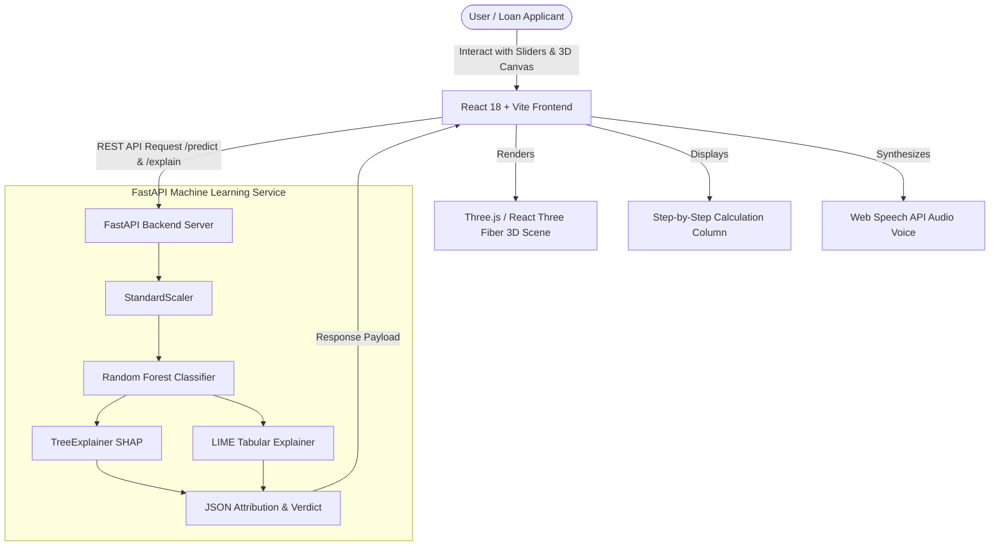

# ⚡ Loanstat Reasoner: 3D Interactive Explainable AI (XAI) Loan Approval Engine

[](https://github.com/ILAKKIYAN12/Loanstat_Reasoner)
[](https://python.org)
[](https://fastapi.tiangolo.com)
[](https://react.dev)
[](https://threejs.org)
[](https://tailwindcss.com)
[](https://opensource.org/licenses/MIT)

> **Loanstat Reasoner** ("Trust the AI") is a full-stack, production-ready Explainable AI (XAI) platform designed to eliminate the algorithmic "black box" in banking and financial credit underwriting. Powered by **SHAP (SHapley Additive exPlanations)**, **LIME (Local Interpretable Model-agnostic Explanations)**, **React 18**, and **Three.js / React Three Fiber**, this system enables loan applicants and financial officers to visually inspect, interact with, and mathematically verify loan approval decisions in real time.

---

## 📑 Table of Contents

- [Key Features](#-key-features)
- [How Decisions Are Made & Calculated](#-how-decisions-are-made--calculated)
- [Architecture & Tech Stack](#-architecture--tech-stack)
- [Project Directory Structure](#-project-directory-structure)
- [Getting Started](#-getting-started)
  - [Prerequisites](#prerequisites)
  - [Backend Setup (FastAPI)](#1-backend-setup-fastapi)
  - [Frontend Setup (React + Vite)](#2-frontend-setup-react--vite)
- [API Documentation](#-api-documentation)
- [Docker & Deployment](#-docker--deployment)
- [Author & Acknowledgments](#-author--acknowledgments)
- [License](#-license)

---

## 🌟 Key Features

### 1. 🎨 Immersive 3D Interactive Visualizations
- **3D Financial Risk Radar Matrix**: Real-time 5-dimensional interactive radar chart rendered using `@react-three/fiber` and `@react-three/drei`. Supports mouse rotation, orbit controls, and zoom.
- **Official 3D Document Paper Stamp Seal**: Real-time 3D stamp slamming onto an authentic A4 paper screen (`✔ APPROVED` in emerald green or `✖ REJECTED` in crimson red) accompanied by physical impact particles and screen shake.
- **3D Needle Gauge**: Physical spring-damped needle gauge visualizing the continuous approval probability percentage (0% to 100%).
- **3D SHAP Waterfall Bar Chart**: 3D extruded bars quantifying positive and negative feature impacts. Clicking any bar highlights the corresponding feature explanation.

### 2. 🔍 Transparent Explainable AI (XAI) Engine
- **SHAP (SHapley Additive exPlanations)**: Calculates game-theoretic Shapley values attributing exact percentage contributions (+38%, -14%, etc.) for every financial feature against a background dataset of 10,000 reference applicants.
- **LIME (Local Interpretable Model-agnostic Explanations)**: Generates localized linear surrogate models around individual applicant decisions.
- **Step-by-Step Mathematical Calculation Column**: Demystifies model predictions by presenting a transparent running mathematical equation starting from the baseline population average (50.0%) to the final computed approval rate.

### 3. 🎯 Counterfactual "What-If" Analysis
- Real-time interactive slider allowing applicants to simulate: *"What minimum credit score would flip my rejection into an approval?"*
- Triggers live model re-evaluations and celebratory confetti upon crossing the approval boundary.

### 4. 🤖 AI Support Assistant & Bug Tracker
- **Real-Time AI Chatbot**: Built-in interactive assistant capable of answering user queries regarding credit score improvement, debt-to-income limits, and underwriting rules.
- **Bug & Issue Submission**: Integrated ticket reporting system generating official reference tracking codes (e.g., `#XAI-BUG-XXXXXX`).

### 5. 🌓 Dual Theme & Modern SaaS UI
- **Light Theme**: Fresh, high-contrast SaaS design featuring Sky-Blue A4 sheet framing, glassmorphism, and bold slate typography.
- **Dark Theme**: One-click toggle switching the entire app into a sleek, deep navy/charcoal interface.
- **Collapsible Sidebar Dock**: Seamlessly connected left-edge vertical navigation dock that expands into a full drawer menu.

### 6. 🌐 Bilingual & Accessibility Features
- Full support for both **English** and **Tamil (தமிழ்)** across all UI elements, explanations, and advice.
- **Voice Text-to-Speech (TTS)**: Built-in Web Speech API synthesizer reading out human-readable reasons in the selected language.
- **Offline ML Fallback**: Client-side heuristic decision engine activates automatically if the backend server becomes unreachable.

---

## 📐 How Decisions Are Made & Calculated

The core predictive model is a **Random Forest Classifier** ($120$ estimators, maximum depth of $8$) trained on financial underwriting datasets achieving an **ROC-AUC score of 0.9781 (97.8% accuracy)**.

### Mathematical Formulation

$$\text{Financial Risk Score} = \underbrace{+2.2 \times \frac{\text{Credit Score} - 580}{100}}_{\text{Repayment History}} + \underbrace{+1.8 \times (\ln(\text{Income}) - 10.5)}_{\text{Earning Capacity}} + \underbrace{+0.25 \times \text{Experience}}_{\text{Job Stability}} - \underbrace{3.5 \times \left(\frac{\text{Loan Amount}}{\text{Income}}\right)}_{\text{Over-leveraging Penalty}} - \underbrace{1.5 \times \frac{\text{DTI} - 30}{15}}_{\text{Existing Debt Burden}}$$

$$\text{Approval Probability } P = \frac{1}{1 + e^{-\text{Score}}}$$

### Step-by-Step Running SHAP Attribution

$$\text{Final Probability} = \text{Baseline Average (50.0\%)} + \sum_{i=1}^{n} \phi_i$$

Where $\phi_i$ represents the Shapley attribution value for feature $i$. A final probability $\ge 50\%$ triggers an approval verdict.

---

## 🏗 Architecture & Tech Stack



### Technology Breakdown
- **Frontend**: React 18, Vite, Three.js, React Three Fiber (`@react-three/fiber`), React Three Drei (`@react-three/drei`), Tailwind CSS, Framer Motion, Lucide Icons, Canvas Confetti.
- **Backend**: FastAPI, Uvicorn, Scikit-Learn, SHAP, LIME, NumPy, Pandas, Joblib, Pydantic v2.

---

## 📁 Project Directory Structure

```plaintext
xai-loan-approval-demo/
├── backend/
│   ├── main.py                 # FastAPI application routes & middleware
│   ├── explainer.py            # SHAP & LIME computation pipeline
│   ├── model_trainer.py        # Dataset generation & Random Forest training
│   ├── model.joblib            # Serialized trained Random Forest model
│   ├── scaler.joblib           # Pre-fitted StandardScaler
│   ├── background_data.joblib  # Reference population dataset for XAI
│   ├── Dockerfile              # Production Docker container definition
│   └── requirements.txt        # Python package dependencies
├── frontend/
│   ├── src/
│   │   ├── components/
│   │   │   ├── Header.jsx          # Top navbar, theme toggle & left dock
│   │   │   ├── Step1Input.jsx      # Preset profiles & dynamic line sliders
│   │   │   ├── Step2Verdict.jsx    # 3D stamp seal reveal & risk rating
│   │   │   ├── Step3Reason.jsx     # SHAP/LIME breakdown & formula column
│   │   │   ├── ThreeCanvas.jsx     # R3F 3D radar, stamp seal & waterfall
│   │   │   ├── GlobalDashboard.jsx # Population aggregate analytics
│   │   │   ├── UserProfile.jsx     # Applicant profile & verified ID card
│   │   │   ├── HelpSupport.jsx     # Interactive AI chatbot & bug report
│   │   │   └── LoginModal.jsx      # Authentication modal
│   │   ├── locales/
│   │   │   ├── en.js               # English language dictionary
│   │   │   └── ta.js               # Tamil (தமிழ்) language dictionary
│   │   ├── utils/
│   │   │   └── api.js              # Axios/Fetch API client with offline fallback
│   │   ├── App.jsx                 # Root state router & theme manager
│   │   ├── main.jsx                # React application entry point
│   │   └── index.css               # A4 frame styles, sliders & dark mode CSS
│   ├── index.html                  # HTML5 template
│   ├── tailwind.config.js          # Tailwind CSS theme configuration
│   ├── vite.config.js              # Vite bundler configuration
│   └── package.json                # Frontend NPM dependencies
├── .gitignore                      # Git ignore patterns
└── README.md                       # Comprehensive documentation
```

---

## 🚀 Getting Started

### Prerequisites
- **Node.js** (v18.0.0 or higher) & **npm**
- **Python** (v3.10, v3.11, or v3.12) & **pip**
- **Git**

---

### 1. Backend Setup (FastAPI)

1. Open your terminal and navigate to the `backend/` directory:
   ```bash
   cd backend
   ```

2. Create and activate a Python virtual environment:
   ```bash
   # Windows (PowerShell)
   python -m venv venv
   .\venv\Scripts\Activate.ps1

   # macOS / Linux
   python3 -m venv venv
   source venv/bin/activate
   ```

3. Install required Python packages:
   ```bash
   pip install -r requirements.txt
   ```

4. *(Optional)* Retrain the model if desired:
   ```bash
   python model_trainer.py
   ```

5. Start the FastAPI backend server:
   ```bash
   python main.py
   ```
   *The backend will start at `http://localhost:8000`.*
   *Interactive API Docs (Swagger): `http://localhost:8000/docs`.*

---

### 2. Frontend Setup (React + Vite)

1. Open a new terminal tab and navigate to the `frontend/` directory:
   ```bash
   cd frontend
   ```

2. Install dependencies:
   ```bash
   npm install
   ```

3. Start the Vite development server:
   ```bash
   npm run dev
   ```
   *The web application will open at `http://localhost:3000`.*

---

## 📡 API Documentation

| Method | Endpoint | Description |
| :--- | :--- | :--- |
| `GET` | `/health` | Returns server status and whether the ML model is loaded. |
| `POST` | `/predict` | Evaluates applicant parameters and returns verdict (`Approved`/`Rejected`) and probability. |
| `POST` | `/explain` | Generates full SHAP & LIME feature attributions, percentage weights, and counterfactuals. |
| `GET` | `/global-insights` | Aggregates feature importance across the reference population. |

---

## 🐳 Docker & Deployment

### Build & Run via Docker
```bash
cd backend
docker build -t trust-the-ai-backend .
docker run -d -p 8000:8000 --name xai-backend trust-the-ai-backend
```

### Static Hosting for Frontend
The frontend is pre-configured for instant zero-configuration deployment on **Vercel** (`frontend/vercel.json`) and **Netlify** (`frontend/netlify.toml`).

---

## 👤 Author & Acknowledgments

- **Lead Developer**: [ILAKKIYAN12](https://github.com/ILAKKIYAN12)
- **GitHub Profile**: [@ILAKKIYAN12](https://github.com/ILAKKIYAN12)
- **Special Thanks**: Scikit-Learn, SHAP, and the React Three Fiber open-source communities.

---

## 📄 License

This project is licensed under the **MIT License** - see the [LICENSE](LICENSE) file for details.
